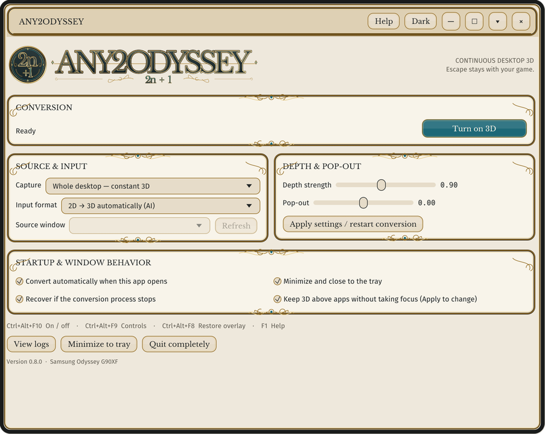
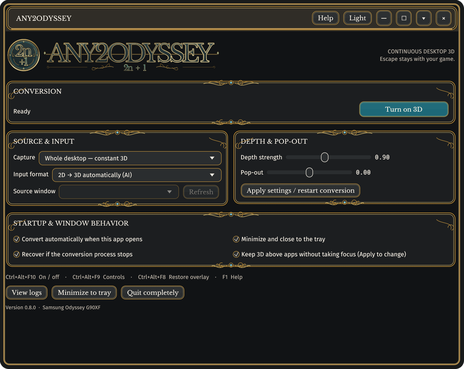
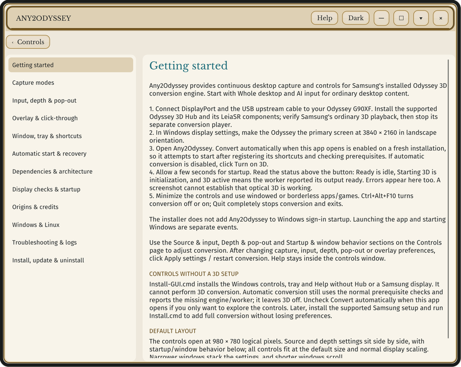
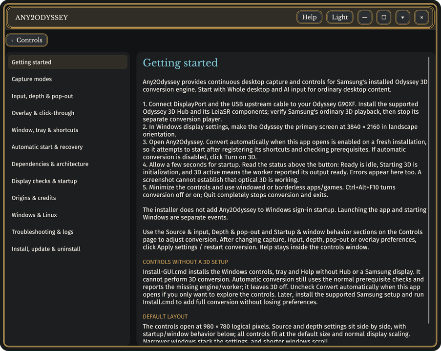

<p align="center"></p>

<h1 align="center">Any2Odyssey</h1>

<p align="center"><strong>Continuous desktop 3D for the Samsung Odyssey 3D G90XF. Written in Rust.</strong></p>

Any2Odyssey is a tray application that turns capturable on-screen content (wallpaper, desktop icons, app windows, web video, borderless games) into glasses-free 3D on Samsung's Odyssey 3D G90XF, by feeding a continuous desktop capture into the conversion engine that Samsung's Odyssey 3D Hub installs. There is no per-video approval step, Escape stays with your game, and the 3D overlay passes mouse input through to the real desktop underneath.

**Credit.** Any2Odyssey is a Rust reimplementation of [Any2Odd](https://zhandragon.itch.io/any2odd) 0.7.3 by **Zhandragon**, released under the GNU GPL-3.0. The architecture, the Samsung engine integration, the capture and overlay design, the behaviour of every control and the written Help all derive from Any2Odd; Any2Odyssey keeps the same license (see [LICENSE](LICENSE) and [NOTICE](NOTICE)). Any2Odd in turn credits Any2C1 (CubeVi) for the continuous-conversion workflow and PortalAI (Zhandragon) for its visual style. Any2Odd's source accompanies its itch.io release; the GitHub repository it names is not public. If this program is useful to you, consider supporting the upstream author through that page.

**Status: 0.8.0 is released and confirmed working on hardware.** The Rust port runs on a Samsung Odyssey 3D G90XF with an NVIDIA RTX 5090, Odyssey 3D Hub 1.5.1 and Windows 11 (build 26300): install, automatic start, whole-desktop AI conversion and the click-through overlay all behave as described. The hardware record is in the [CHANGELOG](CHANGELOG.md).

[Documentation](docs/) · [Platform support](docs/PLATFORMS.md) · [Porting map](docs/PORTING.md) · [Testing](docs/TESTING.md) · [Report an issue](https://github.com/jlobue10/Any2Odyssey/issues)

## A look inside

Rendered with `Any2Odyssey --screenshot` in an isolated preview (no conversion running). The default 980 × 780 window, light and dark.

| Light | Dark |
| --- | --- |
| [](docs/assets/controls-light.png) | [](docs/assets/controls-dark.png) |
| [](docs/assets/help-light.png) | [](docs/assets/help-dark.png) |

## What it does

- Whole-desktop AI conversion, enabled by default when the app opens; selected-window and follow-active-window capture as experimental alternatives; manual side-by-side input for sources that already contain a stereo pair.
- Click-through 3D output that can stay above apps without taking keyboard focus; Ctrl+Alt+F8 restores it.
- GPU capture with a bounded frame queue, exclusion of the output from capture (no feedback trails) and exclusion of the hardware cursor (no delayed duplicate pointer). HDR desktops are normalized to SDR.
- Depth strength and pop-out controls, automatic start, automatic worker recovery, minimize/close to tray, a themed light/dark controls window with built-in Help (F1), tray and jump-list commands.
- An About page with the version, build and installation record, and a check of GitHub Releases for a newer version: on request, or once a day when the controls open (switchable). Nothing is downloaded or installed automatically.
- A single native executable. No .NET runtime, no bundled DLLs.

Automatic side-by-side detection is not implemented. Select side-by-side manually when the source already contains a stereo pair.

## Before you buy: DRM and fullscreen limits

- **Netflix and other DRM-protected video are unsupported.** Protected playback can block Windows screen capture, leaving black or missing video. Any2Odyssey cannot convert or bypass protected video.
- **Exclusive fullscreen is unsupported.** Switch games to **Borderless Fullscreen** (Windowed Fullscreen) or **Windowed** mode. Compatibility varies by game, graphics API, overlays and anti-cheat.

## Requirements

These apply to the full Windows converter. A controls-only installation needs only the Windows row and cannot convert to 3D.

| Component | Required / tested |
| --- | --- |
| OS | Windows 11 x64, 24H2 (build 26100) or newer |
| Display | Samsung Odyssey 3D G90XF, primary monitor, landscape 3840 × 2160 |
| Connection | DisplayPort and the monitor's USB upstream connection; working `3D Stereo WebCam` |
| GPU | NVIDIA RTX 5090 (Any2Odyssey 0.8.0, driver 621.14) and RTX 4090 (upstream Any2Odd) confirmed; the engine receives a fixed 16,384-core hint. Other GPUs are unvalidated |
| Samsung software | Odyssey 3D Hub 1.5.1 and its installed LeiaSR dependencies, in their default `C:\Program Files` locations |
| Install | 64-bit Windows PowerShell 5.1 for the installer scripts; administrator access only to place the worker beside Samsung's engine |

**Who supplies what:** Any2Odyssey supplies the desktop controls, capture, click-through/window management and the worker that loads Samsung's engine. Windows supplies Win32/DWM, Windows Graphics Capture and Direct3D/DXGI. Samsung supplies the conversion engine and AI assets; Samsung/Leia components provide tracking, calibration and optical output. No Samsung or Leia binaries, models or calibration files are included or redistributed.

The app and installer check the exact `ConversionWrapper.dll` SHA-256 of the supported Hub build:

```text
0116b33697ca0192fbe26da96cb9e2592599c0cacfbb1129ae03e445cb3a840b
```

A different engine stops installation and conversion with a compatibility message. Do not remove this check to try an unknown engine.

## Install

### Full Windows 3D converter

1. Install and configure Samsung Odyssey 3D Hub and verify that its ordinary 3D playback works. Stop Samsung's separate 3D player.
2. Download `Any2Odyssey-<version>-windows-x64.zip` from [Releases](https://github.com/jlobue10/Any2Odyssey/releases), verify it against the attached `.sha256`, and extract it to a normal folder.
3. Double-click **Install.cmd** and approve elevation **using the same Windows account** as the existing installation. Alternatively, from 64-bit PowerShell as administrator in the extracted folder:

   ```powershell
   powershell.exe -NoProfile -ExecutionPolicy Bypass -File .\install.ps1
   ```

4. Open **Any2Odyssey** from its desktop or Start menu shortcut as your normal user. By default, conversion starts when the app opens. It does not register itself to start at Windows sign-in.

Administrator access is needed only to install the worker beside Samsung's engine. No restart is needed. The installer does not patch Samsung's executables or DLLs. For a read-only check run `install.ps1 -CheckOnly`; add `-ControlsOnly` to check a GUI-only installation. See [installer/README.md](installer/README.md).

### Windows controls without a 3D setup

On a PC without Odyssey Hub or the Samsung display, double-click **Install-GUI.cmd**. It installs the controls, tray and Help under your Windows account with no administrator access, and appears as **Any2Odyssey (controls only)** in Installed apps. 3D conversion is unavailable in this mode. Install the Samsung setup later and run **Install.cmd** to add full conversion while keeping your settings.

### Upgrading and migrating from Any2Odd

Extract the new ZIP into a new folder and run `Install.cmd`; the installer reports install, upgrade or same-version repair and preserves preferences and logs. It refuses to replace a newer version unless you pass `-AllowDowngrade`.

Any2Odyssey does not replace an installed Any2Odd: it uses its own folders (`%LOCALAPPDATA%\Any2Odyssey`), worker name, registry key and IPC names. Whenever its own `%LOCALAPPDATA%\Any2Odyssey\settings.json` is absent, including on first launch, it imports Any2Odd's conversion preferences if present; deleting `%LOCALAPPDATA%\Any2Odyssey` for a complete reset therefore re-imports them rather than giving defaults, so also delete or rename Any2Odd's `%LOCALAPPDATA%\Odyssey3DCompanion\settings.json` for true defaults. Both can stay installed, but run only one at a time because both drive the same Samsung engine.

### Uninstall

1. Quit Any2Odyssey from its tray menu (**Quit completely**). The uninstaller asks a running instance to quit and waits up to 12 seconds, but a clean exit first is simplest.
2. Open Windows **Settings → Apps → Installed apps**, find **Any2Odyssey** (or **Any2Odyssey (controls only)**) and choose **Uninstall**. This runs the `Uninstall.ps1` that the installer placed in `%LOCALAPPDATA%\Programs\Any2Odyssey`. A full installation requests elevation once for a protected worker-removal helper in Program Files; a controls-only installation needs no elevation. Equivalent command from PowerShell:

   ```powershell
   powershell.exe -NoProfile -ExecutionPolicy Bypass -File "$env:LOCALAPPDATA\Programs\Any2Odyssey\Uninstall.ps1"
   ```

Run the uninstaller as your normal user and approve the helper using the same account. When UAC is disabled, or you are signed in as the built-in Administrator, there is no prompt to approve: the uninstaller runs the helper directly, and the helper still checks the account and its own path before removing anything. Older installations must be repaired with this release before using the protected helper.

What is removed: `Any2Odyssey.exe`, the icon, LICENSE/NOTICE/third-party notices, `USER-GUIDE.html`, `Uninstall.ps1` and `version.json` from `%LOCALAPPDATA%\Programs\Any2Odyssey`; `Any2OdysseyWorker.exe` from `C:\Program Files\Odyssey 3D Hub\Conversion` and `C:\Program Files\Any2Odyssey\UninstallWorker.ps1` (full installs only); the desktop and Start menu shortcuts that point at this installation; and the `HKCU\...\Uninstall\Any2Odyssey` registration. The emptied `%LOCALAPPDATA%\Programs\Any2Odyssey` folder is removed too (it stays if you placed other files in it). Nothing else in Samsung's folders is touched, and no reboot is needed.

What is kept, on purpose: Samsung's Odyssey 3D Hub and LeiaSR software; your preferences, theme, logs and the installer's `install-result.json` record in `%LOCALAPPDATA%\Any2Odyssey`; and `Samsung-OverlaySettings-before.json` in that folder, the copy of Samsung's overlay settings taken before the first conversion. That copy holds Samsung's untouched values only if `OverlaySettings.json` already existed then; if Samsung's file was absent at the first conversion, Any2Odyssey created it, and the backup taken at the next start holds Any2Odyssey's own values, so there is nothing of Samsung's to restore in that case. Delete `%LOCALAPPDATA%\Any2Odyssey` yourself if you want a complete reset (see the note above about Any2Odd preferences being re-imported). To put Samsung's original depth/pop-out values back, close Odyssey 3D Hub and copy that backup over `%USERPROFILE%\AppData\LocalLow\Samsung\Odyssey3DHubUI\SettingsData\OverlaySettings.json`; the uninstaller does not do this automatically because the file may hold newer Samsung settings of your own.

An installed Any2Odd is separate and keeps its own entry in Installed apps; uninstall it through that entry if you no longer want it.

## Controls

| Action | Control |
| --- | --- |
| Turn 3D on / off | Button, tray menu, taskbar jump list, or **Ctrl+Alt+F10** |
| Show controls | Tray double-click, desktop shortcut, or **Ctrl+Alt+F9** |
| Restore overlay without taking game focus | **Ctrl+Alt+F8** or the tray menu |
| Help | **F1** or the Help button |
| About, version and update check | **About** button, right-click or tray menu; `Any2Odyssey --check-updates` from a terminal |
| Apply capture / input / depth / overlay changes | **Apply settings / restart conversion** |

Preferences live in `%LOCALAPPDATA%\Any2Odyssey\settings.json`; the theme choice and the time of the last update check in `ui-settings.json`; `companion.log` and the JSON status files in the same folder. Review and redact window titles, user names and paths before sharing logs.

## Linux

A native Linux build is a project goal with the same scope as Any2Odd's experimental portable edition: themed controls, tray, written Help, side-by-side/anaglyph stereo viewing of images, PNG export, and a bounded live capture of one screen shown on a different output display. Samsung's engine, LeiaSR eye tracking and the G90XF's calibrated output do not exist on Linux, so there is no AI depth and no glasses-free output there. See [docs/PLATFORMS.md](docs/PLATFORMS.md) for the current state.

## Building from source

```sh
cargo build --release            # on Windows x64: the full converter
cargo test --workspace
cargo run -p any2odyssey-iconmaker -- assets   # regenerate icon and wordmark
```

On Windows, `scripts/package.ps1` stages the release ZIP. The repository layout is described in [docs/PORTING.md](docs/PORTING.md).

## License

GPL-3.0-only. Copyright (C) 2026 Jonathan LoBue; derived from Any2Odd, Copyright Zhandragon. See [LICENSE](LICENSE), [NOTICE](NOTICE) and [THIRD-PARTY-LICENSES.md](THIRD-PARTY-LICENSES.md).
